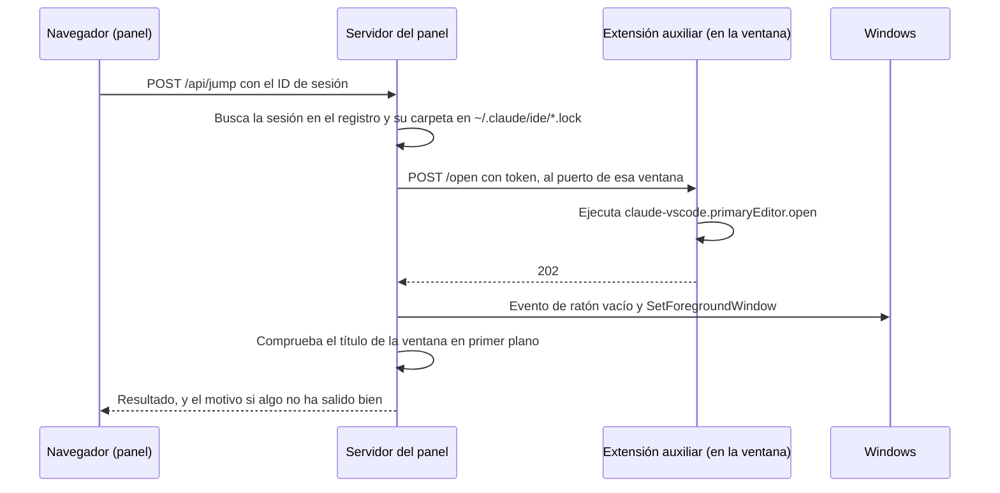

# Cómo funciona el salto del panel a VS Code

Cada sesión iniciada en la extensión de VS Code muestra su logo. En color, la sesión está abierta y al pulsarlo, o al pulsar su notificación, su ventana pasa al frente con su pestaña abierta. En gris, está cerrada y al pulsarlo se reabre. Aquí se explica cómo instalarlo, cómo funciona y por qué está hecho así.

Es solo para Windows y para sesiones abiertas en la extensión de Claude Code para VS Code.

## Instalación

Necesitas la orden `code` en el `PATH`. Desde la carpeta del repositorio:

```
python install_extension.py
```

Empaqueta `vscode-extension/` en un `.vsix` y lo instala con `code --install-extension`. No hace falta Node ni `vsce`.

Para comprobarlo, mira `~/.claude-monitor/windows/`: debe haber un fichero `.json` por cada ventana de VS Code con una carpeta abierta. En nuestras pruebas, las ventanas ya abiertas cargaron la extensión solas. Si falta alguna, ejecuta **Developer: Reload Window** en ella cuando sus sesiones estén paradas.

Para quitarla:

```
python uninstall_extension.py
```

Sin la extensión el salto sigue funcionando, pero más lento, porque usa el enlace `vscode://`.

## El recorrido de un clic



1. **El navegador solo envía el ID de la sesión.** El servidor saca lo demás de sus propios datos, así que una página nunca le dice qué ruta abrir.
2. **El servidor localiza la ventana.** `~/.claude/ide/*.lock` da la carpeta exacta de cada ventana abierta. Una sesión pertenece a la carpeta que coincide con su `cwd` o, si no, a la carpeta padre más cercana.
3. **La pestaña va primero.** Así la ventana aparece ya mostrándola.
4. **La ventana va después.** Se localiza por el título y se trae al frente.

## Reabrir una sesión cerrada

1. **Comprueba que se puede.** La sesión debe haber empezado en la extensión y su carpeta debe seguir existiendo. Esa carpeta sale del historial de la sesión y se guarda en la caché local, nunca en lo que recibe la página.
2. **Busca una ventana con esa carpeta exacta.** Si existe, sigue el mismo recorrido de arriba.
3. **Si no existe, abre una nueva** con `Code.exe <carpeta>` y espera a que la extensión auxiliar y la de Claude se carguen en ella, hasta 45 s. Si tras 30 s con la ventana delante siguen sin responder, usa el enlace. La espera es larga a propósito: en nuestra prueba, la extensión de Claude tardó más de 8 s en cargarse y un enlace enviado antes se perdió.

Es exacta porque la extensión de Claude busca cada sesión en la carpeta donde empezó: una ventana de la carpeta padre no la encontraría. El panel no envía ningún mensaje a la sesión.

Al abrir una ventana, VS Code restaura también las pestañas que tenía, así que pueden aparecer abiertas otras sesiones de esa carpeta.

## Cómo sabe el panel si una sesión sigue abierta

Lee `~/.claude/sessions/<pid>.json` y comprueba que ese proceso sigue en marcha y arrancó cuando dice el fichero. No basta con que Windows conozca el proceso: un proceso muerto sigue existiendo mientras otro programa conserve un identificador abierto hacia él. Por eso también se mira su código de salida.

## Por qué hay una extensión

VS Code no ofrece una orden externa para abrir una pestaña en una ventana concreta. La alternativa es este enlace:

```
vscode://anthropic.claude-code/open?session=<id>
```

Tiene dos problemas:

- **Es lento.** Cada uso arranca un proceso `Code.exe --open-url`, que en nuestras mediciones duraba unos 2,5 s.
- **Puede equivocarse de ventana.** VS Code se lo entrega a la ventana activa. Si no es la de la sesión, la extensión de Claude abriría ahí una segunda copia de una sesión que ya está en marcha.

La extensión auxiliar evita ambos: vive dentro de cada ventana y recibe un mensaje local, sin arrancar nada. Como cada ventana tiene su propio canal, no puede abrir la pestaña en otra.

## Por qué el foco necesitaba un truco

Windows no deja que un proceso en segundo plano le quite el foco a la ventana que estás usando. Cuando pulsas en el navegador, el servidor del panel es ese proceso, y `SetForegroundWindow` puede fallar sin más.

Windows sí lo permite al proceso que acaba de recibir una entrada. Por eso el servidor genera con `SendInput` un **evento de ratón vacío**, que no mueve nada, justo antes de cambiar de ventana. Probarlo con VS Code delante no sirve, porque ahí no se nota el bloqueo: hay que probar con el navegador delante.

## Qué pasa si algo falla

| Situación | Qué hace el panel |
|---|---|
| La ventana no tiene cargada la extensión | Usa el enlace, y solo tras confirmar que su ventana está delante |
| Una actualización de Claude cambia el comando interno | La extensión responde 404 y el panel usa el enlace |
| Windows bloquea el cambio de ventana | Recurre a `Code.exe <carpeta>`, más lento |
| Dos ventanas con el mismo nombre de carpeta | Recurre a `Code.exe <carpeta>` |
| No se confirma la ventana y no hay extensión | No envía el enlace, para no duplicar la sesión, y pide abrir la pestaña a mano |
| La pestaña ya está abierta, pero no se confirma la ventana | Avisa tras 1,5 s como máximo |
| Ventana con varias carpetas, o sin ventana localizable | No hace nada y lo indica |

La ventana se confirma por su título, con el formato por defecto `pestaña - carpeta - Visual Studio Code`. Con un `window.title` personalizado nunca se confirma, así que el salto tarda más y el enlace no se envía.

## Tiempos medidos

Medidos en un solo PC con Windows 11, 8 ventanas abiertas y el navegador delante. Tómalos como referencia:

| Camino | Tiempo total |
|---|---|
| Extensión y cambio directo | 31–145 ms |
| Sin evento vacío, cayendo a `Code.exe` | 3–8 s |

## Seguridad

**En el panel**, `POST /api/jump` exige un `Host` local, el mismo `Origin` que el panel y `Content-Type: application/json`. Solo admite el ID de una sesión abierta en el registro. Otro servidor local en otro puerto queda rechazado.

**En la extensión:**

- Escucha solo en `127.0.0.1`, en un puerto elegido al azar.
- Crea un token nuevo cada vez que arranca y lo publica, con el puerto, en `~/.claude-monitor/windows/<pid>.json`. Cualquier programa que se ejecute con tu usuario de Windows podría leerlo.
- Rechaza cualquier petición con cabecera `Origin`, es decir, las de una página web.
- Solo abre una sesión a partir de su ID. No admite rutas ni mensajes.

Los ficheros `~/.claude/ide/*.lock` guardan también un token de la extensión de Claude. El panel solo lee `workspaceFolders` y nunca usa ese token.

## Diagnóstico

`GET /api/jumps` enseña los últimos 50 saltos. Se guardan solo en memoria:

```json
{"window": "demo", "tab": "window", "tab_ms": 15, "focus": "switch", "ms": 31}
```

| Campo | Valores |
|---|---|
| `tab` | `window` es por la extensión, `link` por el enlace, `none` si no se abrió |
| `focus` | `switch` es directo, `code_exe` por `Code.exe`, `unconfirmed` sin confirmar, `no_code_exe` si no lo encuentra, `new_window` si se abrió una ventana nueva |
| `tab_ms`, `ms` | Milisegundos hasta pedir la pestaña y hasta el final |

Si `focus` sale `code_exe` o `unconfirmed` casi siempre, el problema está en el foco de Windows o en un título personalizado.

## Limitaciones

- `claude-vscode.primaryEditor.open` es un comando interno de la extensión de Claude y puede cambiar. Se probó con la versión 2.1.318 y VS Code 1.144.
- Si ves el panel por un túnel SSH, la ventana se mueve en la máquina del panel, no en la tuya.
